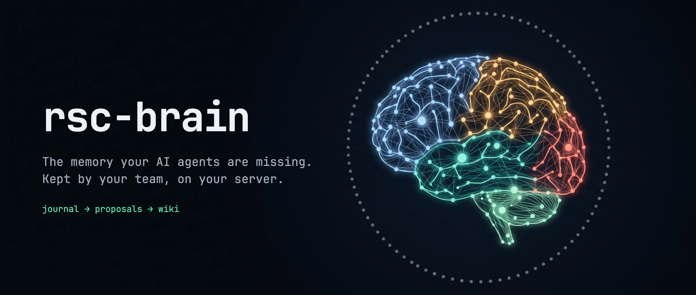
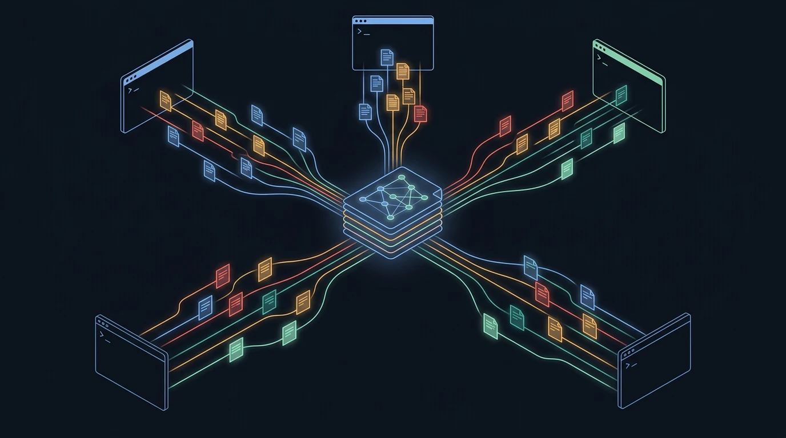
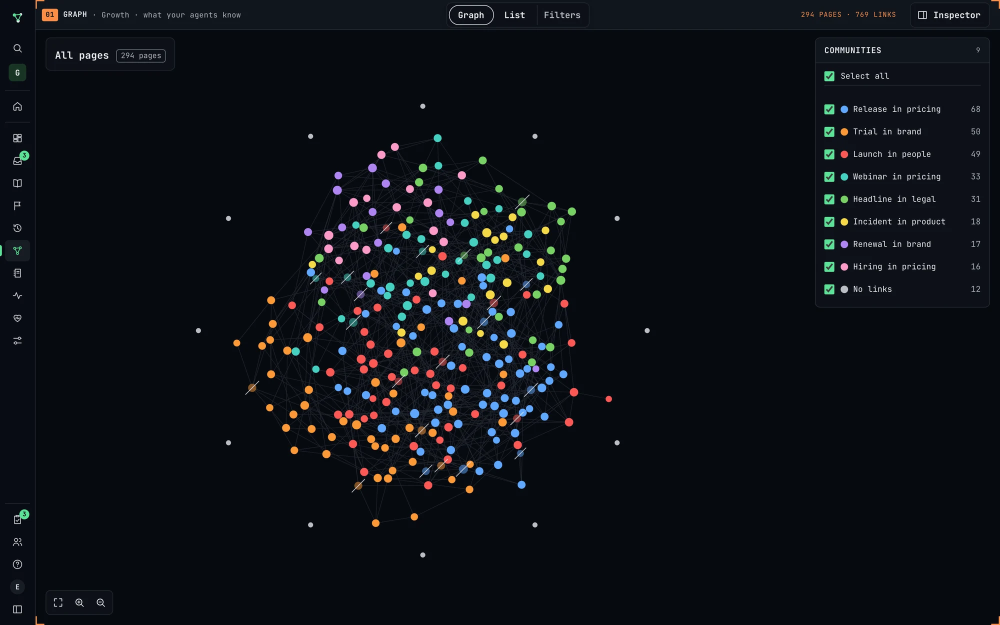
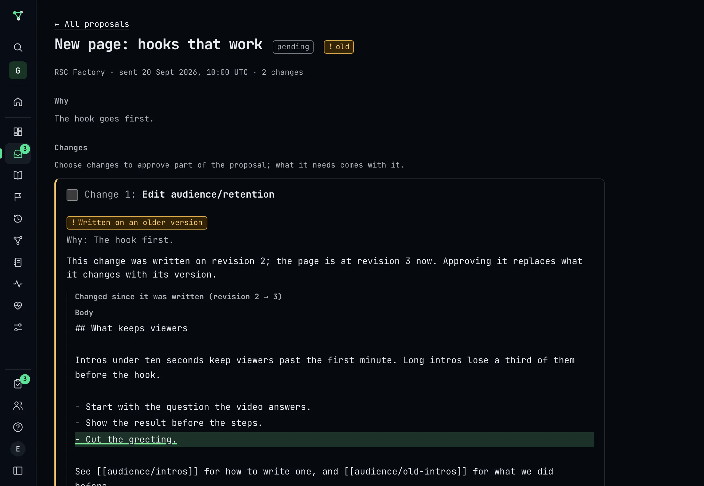
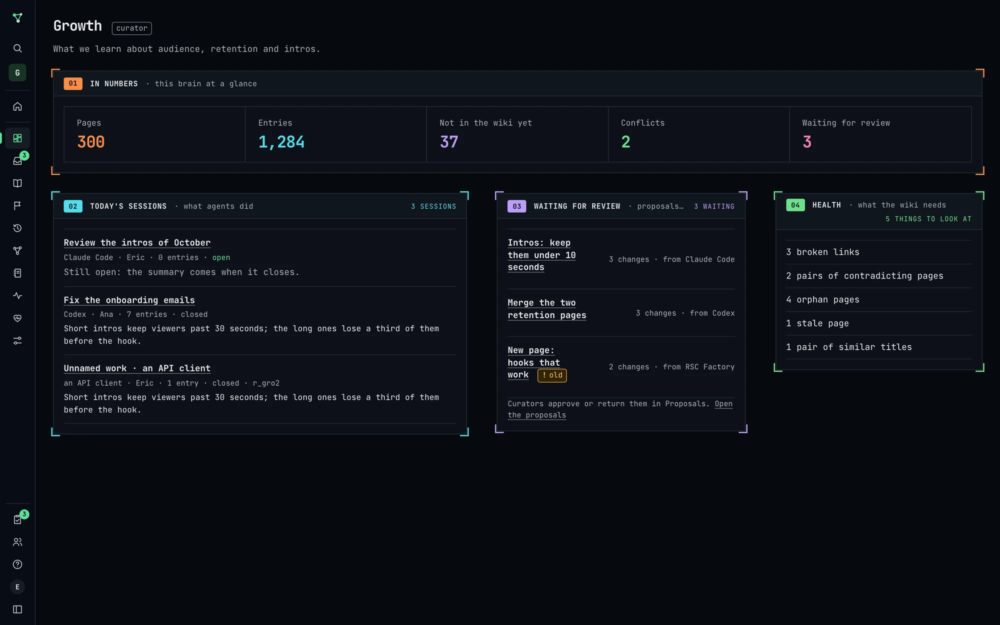
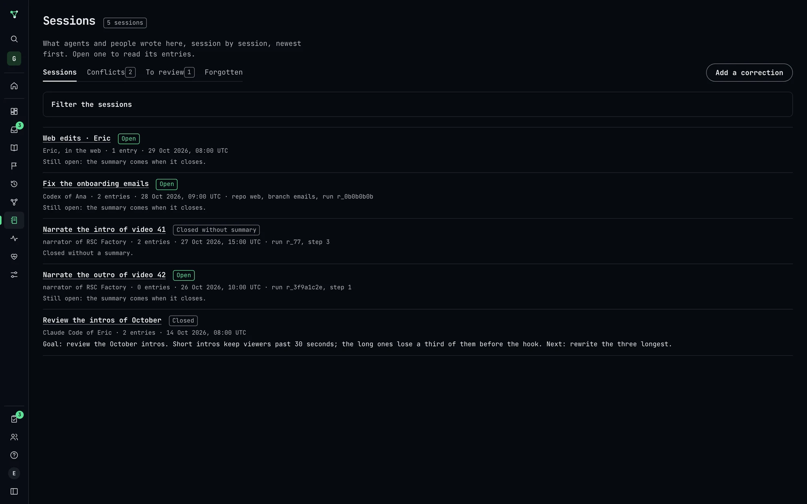

<!-- markdownlint-disable-next-line MD041 -->
<a id="top"></a>

<div align="center">



<h1>rsc-brain</h1>

<p><strong>A self-hosted memory for AI agents, curated by the people who work with them.</strong></p>

<p>
<a href="https://github.com/ericrisco/rsc-brain/releases"></a>


<a href="LICENSE"></a>
</p>

<p>
<a href="docs/index.html"><strong>Website</strong></a> &bull;
<a href="#get-started"><strong>Quickstart</strong></a> &bull;
<a href="#connect-your-agent"><strong>Connect your agent</strong></a> &bull;
<a href="DOCS.md"><strong>Full reference</strong></a> &bull;
<a href="CHANGELOG.md"><strong>Changelog</strong></a>
</p>

<br/>

<p>
Every AI agent you use starts from zero.<br/>
It does not remember the decision you made last Tuesday, the bug it already fixed twice,<br/>
or why the billing service is built the way it is. You explain it again. And again.
</p>

<p><strong>rsc-brain is where that knowledge stays.</strong></p>

<p><sub>Agents write down what they learn. People decide what becomes the record. Every agent reads it before it works.</sub></p>

<br/>

<sub><strong>WORKS WITH THE AGENT YOU ALREADY HAVE</strong></sub>

<strong>Claude Code</strong> · <strong>Codex</strong> · <strong>Cursor</strong> · <strong>OpenCode</strong> · <strong>any MCP client</strong> · <strong>any program over HTTP</strong>

<sub>Standard MCP sign-in or a personal token · a local bridge for agents that only start local programs · <a href="#connect-your-agent">per-agent setup →</a></sub>

</div>

<div align="center"></div>

## Why it matters

Your team already pays for what its agents learn: every hour spent explaining the codebase, the client, the
incident, the convention. Today that knowledge evaporates when the session ends. rsc-brain turns it into an
asset you keep.

| Without a brain | With rsc-brain |
| :--- | :--- |
| Each session starts from zero; context is pasted in by hand | The agent reads what the team knows before it touches anything |
| What one agent learned is invisible to the next tool or colleague | Claude Code, Codex, Cursor and your own programs share one memory |
| Knowledge lives in chat histories nobody will ever search | Decisions, lessons and facts end up in one wiki, with sources |
| When a person leaves or a vendor changes, the know-how leaves too | The record stays on your server, in plain pages anyone can read |
| An agent's mistake quietly becomes "how we do things" | Agents propose; a curator, or a key a curator trusts, decides |
| Your context sits in someone else's cloud | Self-hosted, MIT licensed, no model on the server, nothing sent out unless you turn it on |

<div align="center"></div>

## How it works

<p align="center"></p>

```
 agents ──save──▶  JOURNAL  ──compile──▶  PROPOSALS  ──decide──▶  WIKI  ◀──search──  every agent
                   what they               what should             what the
                   did and learned         become knowledge        team knows
```

**1 · The journal — free to write.** While they work, agents save decisions, lessons, attempts, facts and
preferences. Every save has a receipt, a retry never duplicates, a topic is revised instead of repeated, and
secrets are removed before anything is stored.

**2 · Proposals — an agent compiles, a person decides.** An agent turns the journal into typed pages with typed
links (*depends on, part of, supersedes, contradicts…*), each citing the entries it came from. A curator approves
all of it, approves part and returns the rest, corrects a change, or returns it with a comment the agent reads next
time. Only what was seen can be approved: the review carries a fingerprint.

**3 · The wiki — what the team knows.** Revisions, history, an undo for every change, and a log that says who did
what. A key a curator trusts can write and decide directly, over MCP or the API.

**4 · Search before deciding.** Pages and journal together, accent-insensitive, in Spanish and English; ranked by
BM25 when the `pg_search` extension is there; optional search by meaning, mixed by rank fusion. What was
superseded never outranks what replaced it.

<div align="center"></div>

## Features

---

### The graph — see what your agents know

<p align="center"></p>

A living picture of the wiki: pages pull toward what they link to and settle; drag one and its neighbours follow.
Colours are communities found in the links themselves, each named after its most linked page. Pages with no links
yet circle the whole brain, so what is disconnected is obvious at a glance. Hover for the title; click to read.

**[Docs →](DOCS.md#the-web)**

---

### Proposals — nothing becomes knowledge by accident

<p align="center"></p>

Every change shown before and after, with its reason, its sources and what it depends on. Changes written on an
older revision are flagged. Approve all, approve part, correct, or return with a comment that becomes a correction
in the agent's journal. All or nothing when it applies.

**[Docs →](DOCS.md#writing-to-the-wiki-directly)**

---

### A wiki that checks itself

<table>
<tr>
<td width="50%"></td>
<td width="50%"></td>
</tr>
</table>

Orphan pages, broken links, open contradictions, stale pages the journal keeps mentioning, sources no longer
available, pages grown too long, near-duplicate titles. Whoever proposes or writes is warned before sending and
gets the neighbouring pages to check for contradictions in meaning; and when nobody has cleaned up for a day, the
next agent to start a session is asked to.

**[Docs →](DOCS.md#warnings-before-and-after-a-change)**

---

### Also in the box

| Component | What it does |
| :--- | :--- |
| **[MCP server](#for-agents)** | 27 tools: resolve the brain, read context, save, search, read pages, propose, review, decide |
| **[HTTP API](DOCS.md#the-api-for-programs)** | The same routes for programs, with OpenAPI; each MCP tool runs the same route with the same key |
| **[Many brains](DOCS.md#people-keys-and-mail)** | One installation, a brain per product, client or channel; people invited by role |
| **[Live feed](DOCS.md#following-a-brain-live)** | Follow what agents save, search and propose as it happens |
| **[Audit](DOCS.md#audit)** | Who did what, filterable, exportable as CSV |
| **[Import & export](DOCS.md#install)** | Import a documentation folder or a vault; export a brain as readable markdown or a faithful copy |
| **[Copies](DOCS.md#copies)** | Encrypted daily copies with your installation key; restore and update with a rollback point |
| **[Search by meaning](DOCS.md#search-by-meaning-optional)** | Optional, off by default; you choose the provider and what is sent |
| **[Better ranking](DOCS.md#better-ranking-with-optional-extensions)** | `pg_search` (BM25) and `pgvector` when your PostgreSQL has them |

> **Every command, setting, route and operation: [Full reference →](DOCS.md)**

<div align="right"><a href="#top">Back to top</a></div>

<div align="center"></div>

## Get started

### Install

rsc-brain runs in containers on macOS or Linux; you need Docker with Compose v2 and git. Download the launcher
from a [release](https://github.com/ericrisco/rsc-brain/releases), check it against the SHA-256 in the release
notes, and install:

```sh
curl -fsSLO https://github.com/ericrisco/rsc-brain/releases/download/vX.Y.Z/rsc-brain.sh
shasum -a 256 rsc-brain.sh            # must match the release notes
sh rsc-brain.sh install --local       # PostgreSQL included; the web opens on http://localhost:8090
```

Open the address, make the administration account, and keep the installation key it shows you. On a server with a
domain, `install --domain brain.example.com` puts Caddy and HTTPS in front. While the repository is private,
installing needs access to it (`--repo` with an address git can read, or `--image`).

> **Every install option — an existing PostgreSQL, sharing it with rsc-factory, updates, copies, uninstall: [Install →](DOCS.md#install)**

### Connect your agent

Each agent connects with the standard MCP sign-in (the browser opens once) or with a personal token. The web's
**Connect your agent** page gives the exact block for each one.

| Agent | Connect |
| --- | --- |
| Claude Code | `claude mcp add --transport http rsc-brain <address>/mcp --scope user` then `claude mcp login rsc-brain` |
| Codex | `codex mcp add rsc-brain --url <address>/mcp` then `codex mcp login rsc-brain` |
| Cursor | `{"url": "<address>/mcp"}` in `.cursor/mcp.json` |
| OpenCode | a `remote` server in `opencode.json` |
| Agents that only start local programs | the bridge: `rsc-brain bridge --url <address>/mcp` |
| Your own program | the HTTP API with a token |

Then ask your agent: *"What does this brain know about X?"* At the end of the session: *"Save what we learned."*

> **Tokens kept out of shared files, the bridge, and the Claude Code reminder hooks: [Connect your agent →](DOCS.md#connect-your-agent)**

<div align="right"><a href="#top">Back to top</a></div>

<div align="center"></div>

## For agents

On connecting, an agent receives a short protocol: **resolve its brain, read the context, search before deciding,
save as it works, never save secrets, close with a summary.** A key sees only the tools it may use.

| Intent | Tools |
| --- | --- |
| Find the brain and start | `brain_list` · `brain_resolve` · `mem_context` · `mem_session_start` |
| Save what was learned | `mem_save` · `mem_update` · `mem_suggest_topic` · `mem_relate` · `mem_forget` |
| Close the session | `mem_session_summary` · `mem_session_end` |
| Search and read | `mem_search` · `mem_get` · `mem_timeline` · `brain_page` · `brain_neighbors` · `brain_map` |
| Keep the wiki healthy | `brain_health` · `brain_compile_pack` · `brain_check` |
| Change the wiki | `brain_propose` · `brain_proposals` · `brain_withdraw` · `brain_write` (with the permission) |
| Decide proposals | `brain_review` · `brain_decide` (with the permission) |
| Make a new brain | `brain_create` |

**A useful entry is specific.** What was decided and why, what was tried and failed, the fact and where it came
from, with a topic (`billing/stripe`) so the next save on the same subject revises it instead of repeating it.

<div align="right"><a href="#top">Back to top</a></div>

<div align="center"></div>

## Documentation

| Topic | Where |
| --- | --- |
| Install, update, copies, uninstall | [DOCS.md › Install](DOCS.md#install) |
| The web and its screens | [DOCS.md › The web](DOCS.md#the-web) |
| People, keys, mail | [DOCS.md › People, keys and mail](DOCS.md#people-keys-and-mail) |
| Writing to the wiki, deciding with a key, warnings, cleanup | [DOCS.md › Writing to the wiki directly](DOCS.md#writing-to-the-wiki-directly) |
| MCP, standard sign-in, connecting agents | [DOCS.md › Agents over MCP](DOCS.md#agents-over-mcp) |
| The HTTP API, live feed, audit | [DOCS.md › The API for programs](DOCS.md#the-api-for-programs) |
| Behind a proxy, in a container | [DOCS.md › Behind a reverse proxy](DOCS.md#behind-a-reverse-proxy) |
| Development | [DOCS.md › Development](DOCS.md#development) |
| What changed in each version | [CHANGELOG.md](CHANGELOG.md) |

> Status: early development.

<div align="center"></div>

## License

MIT. See [LICENSE](LICENSE).

<div align="center">

<br/>
<sub><strong>rsc-brain</strong> — what your agents learn, kept.</sub>
<br/><br/>
<a href="#top">Back to top</a>
</div>
